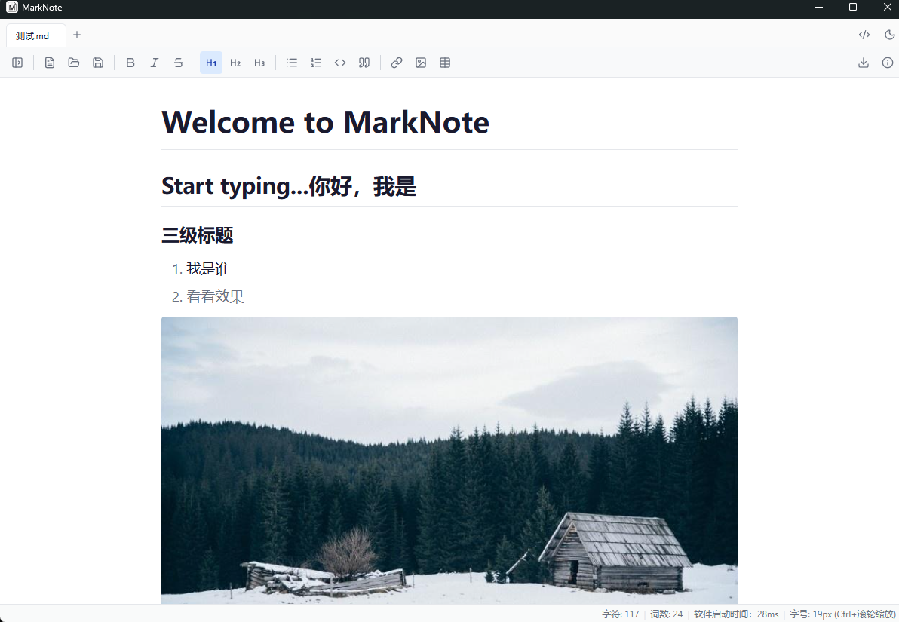
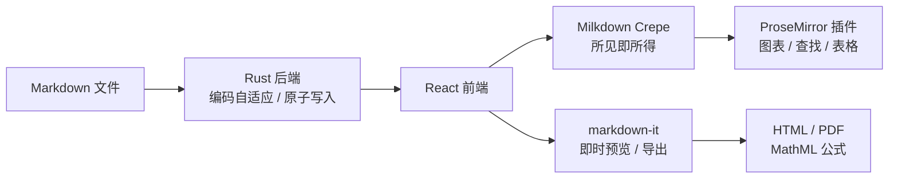

<div align="center">


# MarkNote

**轻量、极速的所见即所得 Markdown 桌面编辑器**

类 Typora 的编辑体验 · Tauri 驱动 · 便携版仅 ~11MB · 离线可用

[](https://github.com/Allenfanng/marknote/releases/latest)
[](LICENSE)
[](https://github.com/Allenfanng/marknote/releases/latest)
[](https://tauri.app)
[](https://react.dev)
[](https://github.com/Allenfanng/marknote/releases)

[下载安装](#-下载安装) · [功能特性](#-功能特性) · [快捷键](#-快捷键) · [技术架构](#-技术栈与架构) · [从源码构建](#-从源码构建) · [版本历史](#-版本历史)

</div>

---

<div align="center">
  
</div>

## ✨ 为什么选择 MarkNote

- **所见即所得** — 基于 Milkdown Crepe（ProseMirror），输入即渲染，告别分屏预览的割裂感。
- **极速轻量** — Tauri + Rust 原生壳，便携版仅 ~11MB（对比 Electron 方案动辄上百 MB）；窗口秒开，编辑器懒加载 + 即时预览无缝衔接。
- **离线可靠** — 安装包内嵌 WebView2 离线运行库，无网络环境也能安装；原子保存 + 会话恢复，崩溃断电不丢稿。
- **为中文写作优化** — 标题霞鹜文楷、GBK 编码自适应、中文按字符计词，开箱即用。
- **完整 Markdown 能力** — 表格、Mermaid/SVG 图表、KaTeX 数学公式、本地图片、查找替换、文档大纲，一个不少。

## 📑 目录

- [功能特性](#-功能特性)
- [下载安装](#-下载安装)
- [快捷键](#-快捷键)
- [性能](#-性能)
- [技术栈与架构](#-技术栈与架构)
- [从源码构建](#-从源码构建)
- [项目结构](#-项目结构)
- [路线图](#-路线图)
- [版本历史](#-版本历史)
- [贡献](#-贡献)
- [许可证](#-许可证)
- [作者与致谢](#-作者与致谢)

## 🚀 功能特性

### 编辑

- **所见即所得** — Milkdown Crepe（ProseMirror）驱动的富文本 Markdown 编辑
- **源码模式** — `Ctrl+/` 一键切换，全页编辑原始 Markdown
- **多标签页** — 浏览器风格标签管理；重复打开同一文件自动定位对应标签；拖拽排序、中键关闭、`Ctrl+W` 关闭、`Ctrl+Tab` 切换
- **标签位置记忆** — 切回标签时滚动位置与光标/选区保持原样；所见即所得模式切标签不重建编辑器、无闪烁
- **查找替换** — `Ctrl+F` 高亮全部匹配 + 逐个跳转，`Ctrl+H` 展开替换；WYSIWYG 与源码模式均支持直接替换 / 全部替换
- **缩放** — `Ctrl+滚轮` 全局缩放并持久化
- **YAML frontmatter** — 开头元数据解析为等宽面板，不会渲染成巨大标题
- **数学公式** — KaTeX 渲染 `$...$` / `$$...$$`，导出同样生效
- **自动保存** — 定时自动保存（覆盖所有打开的标签）+ 关闭未保存文档时确认提示

### 图片

- **本地图片直接显示** — 相对 / 绝对本地路径解析为 asset 协议，编辑器、预览、导出三处一致
- **粘贴即插入** — 剪贴板图片自动写入文档目录 `assets/`，插入相对路径引用
- **拖拽插入** — 从资源管理器拖入图片文件，同样落盘 `assets/`

### 图表

- **Mermaid / SVG 渲染** — ` ```mermaid ` 与 ` ```svg ` 代码块就地渲染成图，光标移入编辑源码、移出恢复图形
- **插入图表** — 工具栏一键插入 Mermaid / SVG 模板
- **全屏查看** — 悬浮「放大」进全屏：滚轮/按钮缩放、拖拽平移、`0` 适应窗口、`1` 原始大小、`Esc` 关闭
- **导出 SVG** — 一键存成独立 `.svg` 文件（固定像素尺寸，外部工具直接可用）

### 表格

- 插入对话框自定义行列数
- 悬停表格边缘即可**加行 / 加列**，左上角手柄菜单**删行 / 删列 / 删表**
- 表头行受保护，避免误删破坏表格结构

### 会话与文件

- **会话恢复** — 退出后重开自动恢复上次标签页（含未保存草稿、各自滚动位置与活动标签）
- **外部变更检测** — 文件被其他程序修改时顶部提示，可重新加载或忽略
- **编码自适应** — 自动识别 UTF-8 / UTF-8 BOM / UTF-16 / GBK
- **原子保存** — 先写临时文件再替换，崩溃 / 断电不损坏原文件
- 打开 / 保存 `.md` `.markdown` `.txt`，安装后自动关联文件类型
- 单实例运行：再次打开文件在已有窗口中新开标签
- 侧边栏：当前目录 / 最近文件 / **文档大纲**（点击标题跳转定位）
- **导出 HTML / PDF**，图表渲染为内联图片，数学公式以 MathML 自包含输出

### 外观

- 日间 / 夜间主题（持久化），Notion/Linear 风格中性配色
- **显示模式切换**：窄栏（固定 860px 居中，专注阅读）与宽栏（正文跟随窗口铺满）
- 中文字体优化（标题使用霞鹜文楷）

## 📥 下载安装

从 [**GitHub Releases**](https://github.com/Allenfanng/marknote/releases/latest) 下载最新版本：

| 文件 | 说明 | 体积 |
|---|---|---|
| `MarkNote_x.y.z_x64-setup.exe` | **推荐**，标准安装版，内嵌 WebView2 离线运行库，无网络也能安装 | ~211MB |
| `MarkNote_x.y.z_x64_en-US.msi` | MSI 安装包，适合批量 / 静默部署 | ~210MB |
| `marknote_x.y.z_portable.exe` | 便携版，免安装（需系统已装 WebView2，Win11 自带） | ~11MB |

**系统要求**：Windows 10/11 (x64)。安装包体积较大是因为内嵌了 WebView2 离线运行库以保证离线可安装；追求小巧可选便携版。

## ⌨️ 快捷键

| 快捷键 | 功能 |
|---|---|
| `Ctrl+N` / `Ctrl+T` | 新建标签页 |
| `Ctrl+O` | 打开文件 |
| `Ctrl+S` | 保存 |
| `Ctrl+/` | 切换源码模式 |
| `Ctrl+F` | 查找 |
| `Ctrl+H` | 查找并展开替换 |
| `Enter` / `Shift+Enter` | 查找时下一个 / 上一个匹配 |
| `Ctrl+W` | 关闭当前标签页 |
| `Ctrl+Tab` / `Ctrl+Shift+Tab` | 切换到下一个 / 上一个标签页 |
| `Ctrl+滚轮` | 缩放编辑区 |
| 鼠标中键 | 关闭标签页 |

## 📊 性能

- **窗口秒开**：编辑器异步懒加载，初始化期间以即时预览无缝衔接，首屏不阻塞。
- **首屏精简**：核心首屏 JS 负载约 380KB；Mermaid（~3MB）仅在文档出现图表时按需加载。
- **便携小巧**：便携版约 11MB，远低于 Electron 同类方案。
- **输入流畅**：字数统计与大纲解析防抖、图表装饰按需重建、工具栏激活态事件驱动，大文档输入不卡顿。

## 🛠 技术栈与架构

| 层 | 技术 |
|---|---|
| 桌面壳 | Tauri v2 |
| 后端 | Rust（Tauri 命令 + rfd 文件对话框 + encoding_rs 编码自适应） |
| 前端 | React 19 + TypeScript |
| 编辑器核心 | Milkdown Crepe（ProseMirror） |
| 预览 / 导出渲染 | markdown-it（+ KaTeX 数学公式） |
| 图表 | Mermaid（按需懒加载） |
| 代码高亮 | CodeMirror 6 |
| 图标 | lucide-react |
| 构建 | Vite 8 |



前端通过 Tauri `invoke` 调用 Rust 命令做文件 I/O；即时预览与导出统一走 markdown-it，所见即所得走 Milkdown，两条渲染链路行为一致。

## 🧑‍💻 从源码构建

**前置依赖**：[Rust 工具链](https://rustup.rs/)（1.77+）、[Node.js](https://nodejs.org/)（18+）、Windows 构建工具链。

```bash
# 安装依赖
npm install

# 开发模式（前端 HMR + Rust 热重载）
npm run tauri:dev

# 仅前端类型检查
npx tsc -b

# 构建安装包（msi + nsis + portable，产物自动同步到 release/）
npm run tauri:build
```

首次构建会自动下载 WiX / NSIS 打包工具与 WebView2 运行库。

> **Windows 提示**：若 Rust 构建被 Defender 拦截（os error 5），将 `src-tauri/target` 加入 Windows Defender 排除列表。

## 📁 项目结构

```
marknote/
├── src-tauri/              # Rust 后端
│   ├── src/lib.rs          # Tauri 命令：文件读写/会话/图片/导出/关窗拦截
│   ├── capabilities/       # Tauri 权限
│   └── tauri.conf.json     # 应用与打包配置
├── src/                    # React 前端
│   ├── components/         # Editor / TabBar / Toolbar / Sidebar / FindReplace ...
│   ├── lib/                # markdown / diagram / findPlugin / imgSrc / outline ...
│   ├── App.tsx             # 主布局 + 标签管理 + 快捷键 + 自动保存 + 会话恢复
│   └── App.css             # 主题系统 + 排版
├── scripts/copy-release.mjs  # 构建产物同步到 release/
└── docs/                   # 截图与设计文档
```

## 🗺 路线图

- [ ] 自定义 CSS 主题
- [ ] 专注模式 / 打字机模式
- [ ] 全局快捷键 / 系统托盘
- [ ] 真正的 PDF 导出（当前为浏览器打印兜底）
- [ ] 大文件防护（2 万行+ 分块渲染）
- [ ] CI（lint + build）与自动更新

欢迎通过 [Issue](https://github.com/Allenfanng/marknote/issues) 提交需求与建议。

## 📜 版本历史

### v1.10.0（2026-11-11）

代码审计修复与重构版本：

- **启动提速**：修复打包耦合，Mermaid 回归真正懒加载，首屏 JS ~4.5MB → ~380KB
- **查找替换**：源码模式连续替换不再改错位置；WYSIWYG 全部替换 O(N²) → O(N)
- **会话恢复**：正确回到上次活动标签
- **图片**：新文档首次保存后立即按正确目录解析
- **导出 KaTeX**：HTML/PDF 渲染数学公式（MathML 自包含）
- **架构**：所见即所得切标签编辑器实例常驻不重建；图表插件按需重建、字数/大纲防抖、工具栏事件驱动
- **体验**：主题持久化、中键关闭标签、最近文件去重、菜单视口钳制、工具栏窄窗口换行

### v1.9.0（2026-10-20）

- 安全与可靠性：原子保存、关窗确认、编码自适应（GBK）、XSS 修复 + CSP、失败提示
- 新功能：查找替换、本地图片（粘贴/拖拽落盘）、会话恢复、外部变更检测、文档大纲、KaTeX
- 改进：自动保存覆盖所有标签、渲染统一 markdown-it、ESLint 清零

### v1.8.0（2026-10-07）

- 标签页切换位置记忆：滚动位置 + 光标/选区跨标签保持

<details>
<summary>更早版本（v1.0 – v1.7）</summary>

- **v1.7.0**（2026-09-05）：插入图表下拉、图表悬浮操作条、全屏查看器、导出 SVG
- **v1.6.0**（2026-09-04）：表格边缘控件、Mermaid/SVG 渲染、显示模式切换
- **v1.5.0**（2026-08-30）：重复打开定位标签、空状态页、交互增强
- **v1.4.x**（2026-08-15）：YAML frontmatter 面板、Typora 风格排版、缩放持久化
- **v1.3.0**（2026-07-24）：导出修复、Ctrl+滚轮缩放、标签右键菜单、.txt 支持
- **v1.2.x**（2026-06）：浏览器式标签页、单实例、文件关联、启动优化
- **v1.1.0**（2026-06-01）：工具栏、源码模式、主题切换、Notion/Linear 风格 UI
- **v1.0.0**：WYSIWYG 编辑、文件读写、主题、快捷键、Windows 安装包

</details>

完整更新记录见 [Releases](https://github.com/Allenfanng/marknote/releases)。

## 🤝 贡献

欢迎提交 Issue 与 Pull Request：

1. Fork 本仓库并创建特性分支（`git checkout -b feat/your-feature`）
2. 提交前确保 `npx tsc -b` 与 `npx eslint src` 通过
3. 提交信息遵循约定式格式（`feat:` / `fix:` / `refactor:` / `docs:`）
4. 发起 Pull Request 并描述改动与验证方式

## 📄 许可证

本项目基于 [MIT 许可证](LICENSE) 开源。

## 👤 作者与致谢

**作者**：FZ · 📧 fung9108@163.com

MarkNote 站在这些优秀开源项目的肩膀上：

- [Tauri](https://tauri.app) — 轻量跨平台桌面壳
- [Milkdown](https://milkdown.dev) / [Crepe](https://milkdown.dev) — 所见即所得 Markdown 编辑器
- [ProseMirror](https://prosemirror.net) — 富文本编辑内核
- [markdown-it](https://github.com/markdown-it/markdown-it) — Markdown 渲染
- [Mermaid](https://mermaid.js.org) — 图表渲染
- [KaTeX](https://katex.org) — 数学公式渲染
- [CodeMirror](https://codemirror.net) — 代码高亮
- [lucide](https://lucide.dev) — 图标

如果 MarkNote 对你有帮助，欢迎点一个 ⭐ Star 支持！